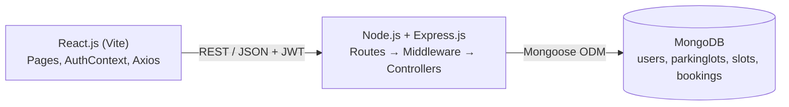
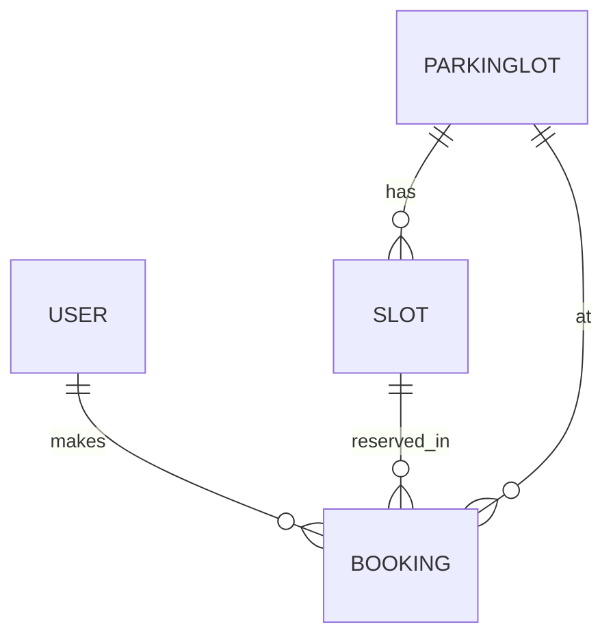

# Architecture, Database Design and API

## 1. Architecture diagram

Request flow (booking a slot):
1. User picks a lot, time window and bay in React (`LotDetail.jsx`).
2. Axios sends `POST /api/bookings` with the JWT in the `Authorization` header.
3. `protect` middleware verifies the token; `bookingController.createBooking` validates input,
   checks for an overlapping confirmed booking on that slot, calculates the amount, saves to MongoDB.
4. The API returns the booking (or a 400/409 error message) and React shows it in "My bookings".

## 2. Database design (MongoDB collections)

**users**: `name`, `email` (unique), `password` (hashed), `vehicleNumber`, `role` (user|admin), timestamps

**parkinglots**: `name`, `address`, `pricePerHour`, `isActive`, timestamps

**slots**: `lot` → parkinglots, `label` (A1, B3…), `type` (car|bike|ev|disabled), `isActive`
 · unique index on (`lot`, `label`)

**bookings**: `user` → users, `lot` → parkinglots, `slot` → slots, `vehicleNumber`,
 `startTime`, `endTime`, `amount`, `status` (confirmed|cancelled), timestamps

**Availability rule:** a slot is busy for a window `[start, end)` if a confirmed booking exists with
`booking.start < end AND booking.end > start`.

## 3. API details

| Method | Endpoint | Access | Purpose |
|---|---|---|---|
| POST | /api/auth/register | public | Create account |
| POST | /api/auth/login | public | Log in, returns JWT |
| GET | /api/auth/me | user | Current user |
| GET | /api/lots | public | List lots with availability |
| GET | /api/lots/:id?start&end | public | Lot + slots with `booked` flag for the window |
| POST | /api/lots | admin | Create lot and generate slots |
| PUT | /api/lots/:id | admin | Update lot |
| DELETE | /api/lots/:id | admin | Delete lot and slots (blocked if active bookings) |
| POST | /api/bookings | user | Create booking |
| GET | /api/bookings/mine | user | My bookings |
| GET | /api/bookings | admin | All bookings |
| PUT | /api/bookings/:id | owner/admin | Change end time |
| DELETE | /api/bookings/:id | owner/admin | Cancel booking |

Errors return `{ "message": "..." }` with 400 (validation), 401 (not logged in), 403 (forbidden),
404 (not found), 409 (slot clash / duplicate).

## 4. Suggested team roles (4 members)

| Member | Role | Owns |
|---|---|---|
| 1 | React frontend | `frontend/src/pages`, `components`, routing, styling |
| 2 | Express/Node backend & APIs | `routes`, `controllers`, `server.js`, error handling |
| 3 | MongoDB & database | `models`, indexes, `seed.js`, DB design doc |
| 4 | Auth, integration & testing | `middleware/auth.js`, `AuthContext.jsx`, `api.js`, Postman tests, screenshots, demo |

## 5. Test checklist (for screenshots / demo)
1. Register, log in, log out
2. Book a bay, then try booking the same bay for an overlapping time (expect 409 message)
3. Extend and cancel a booking
4. Log in as admin: add, edit, delete a lot
5. Open `/admin` as a normal user (redirected)
